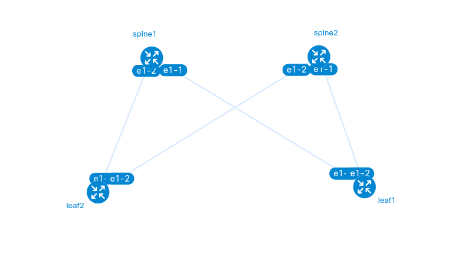

# Network Config Manager

A small web app for backing up, changing and rolling back the configuration of Nokia SR Linux devices. Built with Django and htmx, tested against a 4-node Containerlab lab.



## Features

- **Backup**: pull the running config (`info flat`) from one or many devices in parallel; view, download and compare backups.
- **Deploy**: pick a Jinja2 template; the form is built from its variables. Preview the rendered config per device, then apply exactly what was previewed.
- **Rollback**: restore a device to any backup. The preview lists the `delete` and `set` commands that will be sent, all in one commit.
- **Safety**: an automatic backup before every deploy and rollback, `discard` on any device error, one operation per device at a time, login required on every page.

## Quick start

Requires Docker and [Containerlab](https://containerlab.dev).

```bash
git clone https://github.com/mecebeci/network-config-manager.git
cd network-config-manager

# 1. Start the lab (2 spines + 2 leaves, management IPs 172.21.20.11-14)
cd lab && sudo containerlab deploy -t topology.yaml && cd ..

# 2. Configure: set DJANGO_SECRET_KEY, device credentials are the lab defaults
cp .env.example .env

# 3. Start the app and set up the database
docker compose up -d --build
docker compose run --rm web python manage.py migrate
docker compose run --rm web python manage.py createsuperuser
docker compose run --rm web python manage.py loaddata lab
```

Open http://127.0.0.1:8000 and log in. Devices are managed in the Django admin (`/admin/`).

The app joins the lab's `srlinux-mgmt` Docker network, so deploy the lab first. If the lab is redeployed, run `docker compose up -d --force-recreate`.

## Development

```bash
python -m venv .venv && source .venv/bin/activate
pip install -r requirements.txt
python manage.py runserver 127.0.0.1:8000
pytest
```

Config templates live in [`device_templates/`](device_templates/README.md).

## Limitations

- Configs are handled as flat text over SSH, without the YANG schema. Rollback works this out from the text, so a `delete` can be wider than needed (the lines it removes are sent back in the same commit), and deleting a new entry of a list it does not know fails safely (device unchanged).
- Multi-line values (login banner, certificates) are not restored by rollback; the preview lists them.
- Commands are sent line by line, so large changes take a few seconds.
- Backups contain the device users' password hashes; they are only visible after login.
- Meant to run locally (`127.0.0.1`) by a small team: the per-device lock works within a single process.

## More

- [Architecture and design decisions](docs/ARCHITECTURE.md)
- v1 was a CLI tool; see tag [`v1.0-cli`](https://github.com/mecebeci/network-config-manager/tree/v1.0-cli).
