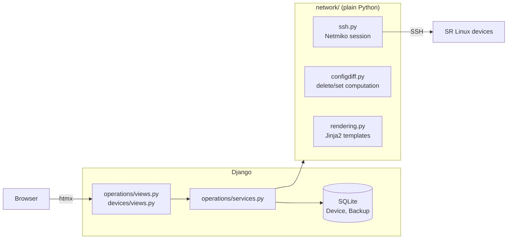
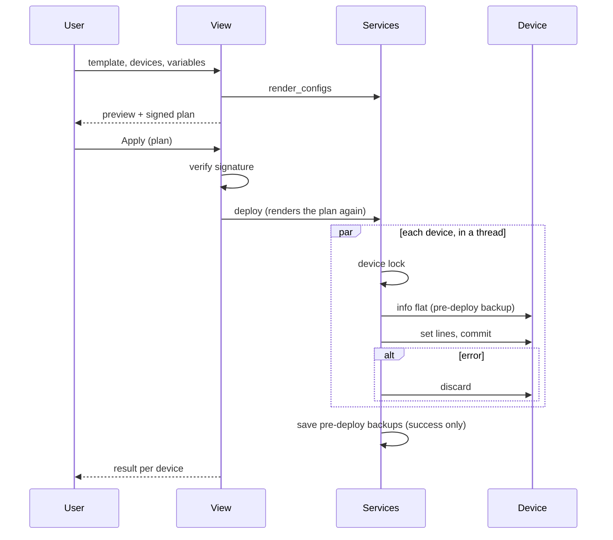

# Architecture

## Layout



| Part | Role |
|---|---|
| `network/` | Everything SR Linux specific: SSH session, `info flat`, `commit`/`discard`, error detection, config diffing, template rendering. No Django imports, so it is tested without a database. |
| `operations/services.py` | The operations: backup, deploy, rollback. Uses `network/` and writes `Backup` rows. Views never talk to a device directly. |
| `operations/views.py` | Forms, signed plans, rendering results. |
| `devices/` | The `Device` model, edited in the Django admin. |
| `device_templates/` | Jinja2 config templates, managed in git. |

## Deploy



## Rollback

```mermaid
sequenceDiagram
    participant U as User
    participant S as Services
    participant D as Device
    U->>S: Restore backup
    S->>D: info flat (running)
    S-->>U: deletes + sets, signed plan
    U->>S: Apply (plan)
    S->>D: info flat again (under device lock)
    S->>S: recompute; refuse if it differs from the plan
    S->>D: deletes + sets, one commit
    alt error
        S->>D: discard
    end
    S->>S: save pre-rollback backup (success only)
```

Rollback commands come from comparing the running config with the backup as text:

- A line on the device but not in the backup is deleted at the first path token the backup does not have (`delete / system ntp`). If that token is a known list name, its key is included (`... subinterface 0`).
- Only the backup lines that are missing on the device, or that fall under one of the deletes, are sent back. Sending all ~600 lines took ~15 s; this takes ~4 s.
- Multi-line statements (banners, certificates) cannot be sent line by line. They are never deleted and never restored; the preview lists them.

## Decisions

| Decision | Why |
|---|---|
| Devices in the database, edited in the Django admin | Login-protected inventory editing for free; no YAML loader. |
| Device credentials only in `.env` | Secrets stay out of the database and fixtures. |
| Backup content in the database (`TextField`) | Configs are a few KB. Backups are addressed by id, so there are no file paths to sanitize; a diff is a comparison of two strings. |
| `network/` free of Django | SR Linux knowledge stays in one place and is easy to unit test with a mocked Netmiko. |
| Signed plans (`django.core.signing`) between preview and apply | Apply runs exactly what was previewed. The browser cannot change devices, template or variables. |
| Rollback re-reads the device before applying | If the config changed after the preview, the commands would differ; the apply is refused instead of sending something nobody saw. |
| Pre-deploy/pre-rollback backup read in the same SSH session, saved only on success | One login per device. A failed change is discarded, so the device is unchanged and there is nothing to restore. |
| Threads only talk to devices; the main thread writes to the database | SQLite does not like parallel writers, and threads would leave open database connections. |
| Per-device `threading.Lock`, gunicorn with one worker | The SR Linux candidate is shared by all sessions on a device, so two changes must not overlap. One process keeps the lock simple. |
| Templates are files in git, not editable in the web UI | Jinja2 without a sandbox would allow server-side template injection. Templates are code and get reviewed like code. |
| `StrictUndefined` in Jinja2 | A missing variable fails the preview instead of producing a broken config line. |
| Flat text over SSH (Netmiko), not gNMI | The goal was a CLI/Netmiko tool. gNMI `Set replace` would compute deletes on the device and be atomic, but would change templates, backups and the rollback logic. |
| htmx with server-rendered HTML | No JavaScript build and no API layer; Django forms and templates do the work. |
| Only listens on `127.0.0.1`, plain HTTP | A local lab tool. HTTPS settings would break login over HTTP. |
